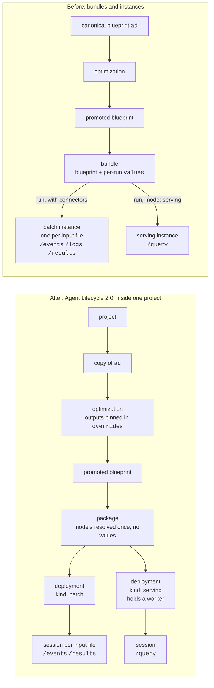
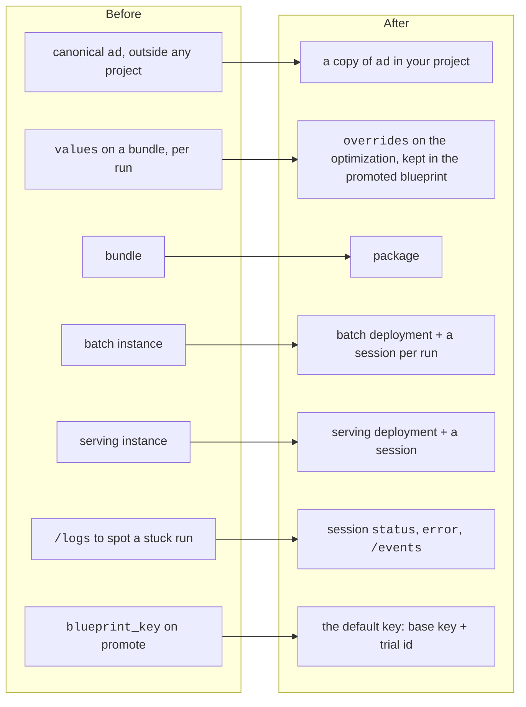

# Migrating to Agent Lifecycle 2.0

How this quickstart moved from bundles and instances to **projects, packages,
deployments and sessions**, and what to watch for if you move your own scripts.
Everything below was run end to end on 2026-10-30 with an API key that is **not**
an org admin.

`/api/agents/bundles` and `/api/agents/instances` are being retired: move to the
calls below. To check that your deployment of the platform serves them, `GET
{root}/api/agents/sessions?limit=1` should answer 200, not 404.

## Before and after

- **Project:** where everything lives. Every object takes its project from the
  one it was made from: an optimization from its blueprint, a promoted blueprint
  from its optimization, a package from its blueprint, a deployment from its
  package, a session from its deployment.
- **Package:** one blueprint, target `platform`, with its models resolved when it
  is built (`resolved_models`: the encoder `mdl_…` and the fitted detector
  `aar_…`). It has **no values**.
- **Deployment:** the package placed to run. `batch` is ready at once; `serving`
  places and loads the agent on a worker, usually within seconds, and holds that
  worker until it is stopped.
- **Session:** a run on a deployment. On `batch`, one run over its input files.
  On `serving`, a client's handle on the loaded agent, answering `/query` once it
  is `running` and staying open until it is cancelled or the deployment ends.
  Several sessions can share one serving deployment.

## What moved where

| Before | After | Why it changed |
|---|---|---|
| canonical `ad`, outside any project | a copy of `ad` in your project | a deployment needs a project, and everything takes its project from the blueprint it starts from |
| per-run `values` on a bundle | `overrides` on the optimization | a package has no values: it runs the blueprint as promoted |
| bundle | package | its models are resolved once, at build time |
| instance (batch) | batch deployment + a session per run | the deployment is set up once; each run is a session |
| instance (serving) | serving deployment + a session | the deployment holds the loaded agent; sessions are clients of it |
| `/logs` | session `status`, `error`, `/events` | a session reaches a terminal status and says why |
| choosing `blueprint_key` on promote | the default key | choosing one takes the admin role |

## Old calls, new calls

All paths are under `{root}/api/agents` unless shown otherwise.

| Before | After |
|---|---|
| — | `POST {root}/api/projects` `{name, description}` |
| optimize the canonical `ad` | `POST /blueprints/ad/copy` `{project_id, blueprint_key}`, then optimize the copy |
| `POST /bundles` `{blueprint, values}` | `POST /packages` `{blueprint_ids: [blp_…], target: {kind: "platform"}, name}`; poll until `ready` |
| `POST /bundles/{id}/run` `{connectors}` | `POST /deployments` `{package_id, kind: "batch"}`, then `POST /sessions` `{deployment_id, connectors: {source: [...]}}` |
| `POST /bundles/{id}/run` `{mode: "serving"}` | `POST /deployments` `{package_id, kind: "serving"}`; poll until `ready`; `POST /sessions` `{deployment_id}`; poll until `running` |
| `GET /instances/{id}` | `GET /sessions/{id}` (`status`, `error`, `job_id`) |
| `GET /instances/{id}/events`, `/logs` | `GET /sessions/{id}/events` (newest first; there is no `/logs`) |
| `GET /instances/{id}/results` | `GET /sessions/{id}/results` |
| `POST /instances/{id}/query` | `POST /sessions/{id}/query` (same body, same `response`) |
| `POST /instances/{id}/cancel`, `DELETE /instances/{id}` | `POST /sessions/{id}/cancel`, `DELETE /sessions/{id}` |
| `DELETE /bundles/{id}` | `POST /deployments/{id}/stop`, `DELETE /deployments/{id}`, then `DELETE /packages/{id}` |
| `GET /instances?bundle_id=` | `GET /deployments?package_id=`, `GET /sessions?deployment_id=` |

Statuses: package `building → ready | failed`; deployment `deploying → ready →
stopping → stopped | failed`; session `pending → running → completed | failed |
cancelled` (and `paused`).

## What changed in practice

1. **Get into a project by copying `ad`.** A deployment needs its package in a
   project, and a package lands in its blueprint's project. The canonical `ad` is
   outside any project, and `POST /optimizations` takes no `project_id`, so an
   optimization on `ad` itself, and everything promoted from it, ends up outside
   one. Copy `ad` into the project first and optimize the copy
   (`fit/atai.py`, `base_blueprint()`). Copying needs only the right to modify the
   project.

2. **A package has no values, so pin what you need at optimization time.** A
   bundle could override any blueprint value per run. Now a package runs the
   promoted blueprint exactly as stored, so outputs a later stage needs go in the
   optimization's `overrides.values`, which are kept in the promoted blueprint.
   Stage 4 pins `output_score: true` (`fit/optimize.py`); `runner_config` overrides
   are gone with the bundles.

3. **The delivery runs at the optimized step.** `step_size` is also the fit step,
   so it can't be pinned differently for delivery. The bundle version delivered at
   step 1 (one score every 3 minutes) through a bundle override. It now delivers at step 8
   (every 24 minutes), the step Optimize chose and the eval scored. Detection and
   AUROC are within half a point of step 1; delays are timed in 24-minute steps.

4. **Serving still sets its own cadence.** A `/query` carries one whole window,
   and the client chooses which windows to send. Stage 8 replays at the
   blueprint's step, so its windows are Stage 6's, one for one. A query holding
   several windows gets them at the blueprint's step.

5. **Turning embeddings on needs its own blueprint.** With `output_embeddings` on,
   one delivery file's batch output was 327 MB, so the main blueprint keeps it
   off. `fit/app_blueprint.py` runs a 1-trial optimization pinning the winner's
   values plus `output_embeddings: true` and promotes it, for the app and
   `fit/library_embeddings.py`. Its trial scores the same as the winner (validation
   macro-F1 0.8547).

6. **No admin key anywhere.** Two calls that would need one were avoided:
   - `POST /blueprints` (registering an edited copy of a promoted blueprint, which
     would have kept its `aar_…` detector without a refit) takes the admin role;
   - `blueprint_key` on `POST /optimizations/{id}/trials/{id}/promote` takes it too.
     Without it the key defaults to `<base key>-<trial id>`, so with the copy named
     `ad-tep-qs` the promoted blueprint is still `ad-tep-qs-otr_…`.

7. **A session's result `ref` is a root path.** `/sessions/{id}/results` returns
   `ref: "/api/files/<fil_…>/content"`, which already includes `/api`; appending it
   to an `…/api` base gives `/api/api/…` and a 404 (`ad_api.py`, `_download`).

8. **Status is reliable, and `error` says why.** Instances needed `/logs` to spot a
   run stuck at `running`. A session reaches a terminal status and carries
   `error`; `ad_api.poll_session` follows `status` and prints `/events`.

9. **Cleanup goes session, deployment, package.** Each holds the next. Cancel a
   session that is still going and stop a deployment that is still up before
   deleting them. `fit/cleanup.py` starts from each recorded package and lists
   its deployments and their sessions, so ones a script never recorded are found
   too. A promoted blueprint can be deleted before its optimization; delete the
   copy of `ad` and then the project last.

## This repo, file by file

| File | Change |
|---|---|
| `ad_api.py` | `create_package`, `deploy`, `open_session`, `wait_running`, `poll_session`, `end_session`, `end_deployment`; results from sessions; the bundle and instance helpers removed |
| `fit/atai.py` | `base_blueprint()`: the project `AD TEP quickstart` and its copy of `ad` (`fit/out/project_state.json`) |
| `fit/optimize.py`, `fit/app_blueprint.py` | optimize the project's copy; `output_score` pinned |
| `fit/test.py`, `fit/app_blueprint.py` | promote without `blueprint_key` |
| `fit/deliver.py`, `fit/library_embeddings.py` | one batch deployment, a session per file |
| `fit/serve.py` | a serving deployment and one session; all three deleted on exit |
| `app-serving/scripts/serving-bridge.js` | the same, plus replacing a session that stops taking queries, and redeploying if the deployment is gone |
| `fit/cleanup.py` | sessions, deployments, packages, found from each package |

## Results against the earlier runs

| Stage | Measure | Lifecycle 2.0, step 8 | Bundles, step-1 delivery |
|---|---|---|---|
| 4 | validation macro-F1, k 5 / k 10 | 0.8547 / 0.8540 | 0.8547 / 0.8540 |
| 5 | test macro-F1 | 0.7331 | 0.7331 |
| 7 | detection / false alarms / AUROC | 78.5% / 2.11% / 0.903 | 78.0% / 1.41% / 0.901 |
| 8 | served against batch | 230/230, median 889 ms | every label and score, at step 1 |

The optimization, the test and the delivery's headline are unchanged by the move;
the false-alarm rate differs because the delivery is now scored at step 8, with
8 times fewer normal windows to set and check the threshold on.

## Moving your own scripts

1. Create a project, or reuse yours, and copy the blueprint you start from into it.
2. Move every per-run `values` override into the optimization's `overrides`, or into
   a separate promoted blueprint if only some runs need it.
3. Replace `bundles` with a package (poll until `ready`), and each run with a
   session on a `batch` or `serving` deployment.
4. Read `/sessions/{id}/events` and `/results`, and resolve result refs against
   the root, not against `…/api`.
5. Clean up sessions, then deployments, then packages; stop serving deployments
   when you're done, since each holds a worker.
